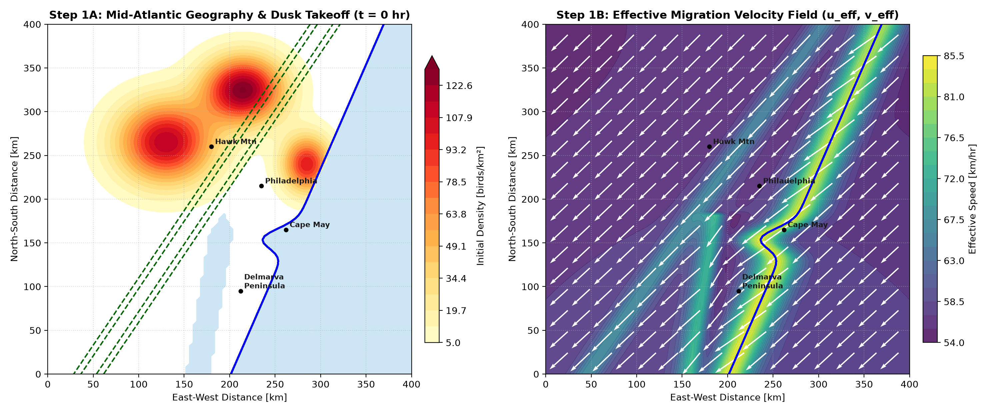
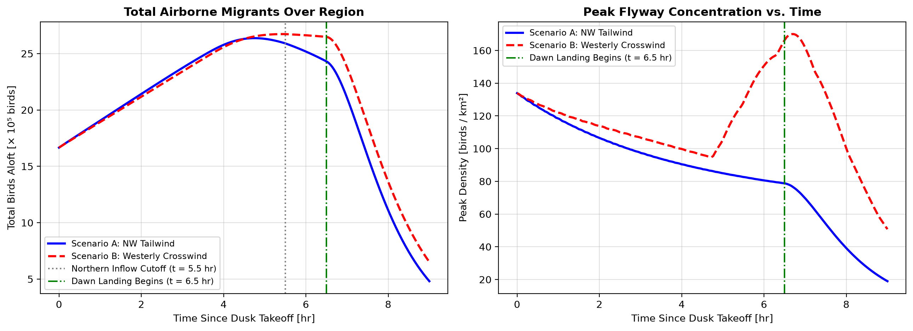
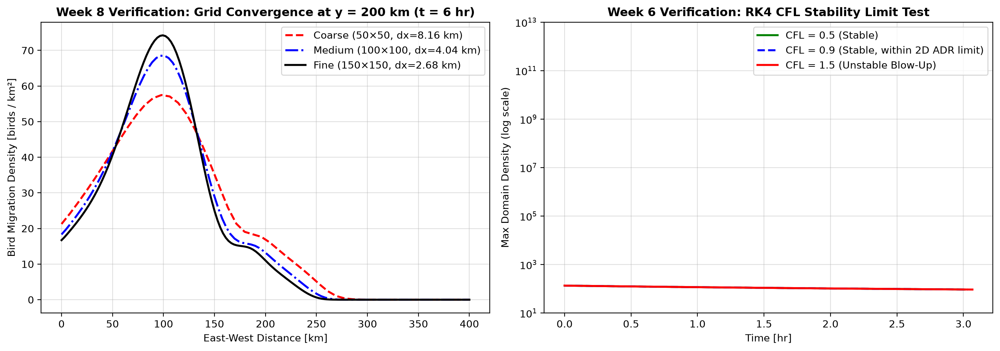

# 2D CFD Modeling of Nocturnal Bird Migration Corridors
**Course:** ENGR4576/5576 – Computational Fluid Dynamics  
**Deliverable:** 5-Minute Project Progress Update & Working Prototype

---

## 1. The Problem Statement
Large-scale nocturnal bird migration behaves macroscopically like an active fluid continuum advected by synoptic atmospheric winds and guided by geographic boundaries. Inspired by BirdCast regional migration radar forecasts, this project develops a 2D Computational Fluid Dynamics (CFD) solver in Python to model the spatiotemporal evolution of nocturnal bird migration density $\rho(x, y, t)$ across a $400\text{ km} \times 400\text{ km}$ Mid-Atlantic flyway covering Eastern Pennsylvania, New Jersey, Delaware, and Maryland. Specifically, the model investigates how synoptic wind direction, coastline avoidance, mountain-ridge channeling, and dawn landing behavior interact to form high-density migratory bottlenecks.

---

## 2. Method of Solution
Bird migration density $\rho(x, y, t)$ [$\text{birds/km}^2$] is governed by the 2D unsteady Advection-Diffusion-Reaction (ADR) equation:

$$\frac{\partial \rho}{\partial t} + \frac{\partial (u_{\text{eff}} \rho)}{\partial x} + \frac{\partial (v_{\text{eff}} \rho)}{\partial y} = D \left( \frac{\partial^2 \rho}{\partial x^2} + \frac{\partial^2 \rho}{\partial y^2} \right) + S(x, y, t)$$

* **Effective Velocity Field ($\vec{V}_{\text{eff}}$):** Combines an active southwest autumn flight heading ($\vec{V}_{\text{bird}}$ at $28\text{ km/hr}$) with partial atmospheric wind drift ($\alpha \vec{V}_{\text{wind}}$), smooth shoreline repulsion along the Atlantic Ocean and Chesapeake Bay (forming the Delmarva Peninsula), and topographic channeling along the Appalachian/Kittatinny Ridge.
* **Spatial Discretization (Week 6):** Solved on a uniform 2D Cartesian mesh using **first-order upwind differencing** (flux splitting based on local velocity signs) for convective terms to eliminate dispersion oscillations and maintain $\rho \ge 0$, paired with **second-order central differencing** for flock dispersion ($D = 8.0\text{ km}^2/\text{hr}$).
* **Boundary & Source Conditions:** A time-varying Dirichlet inflow boundary at the northern edge ($y = 400\text{ km}$) models migrants entering from NY and New England overnight ($t \le 5.5\text{ hr}$), zero-gradient Neumann conditions govern outflow boundaries, and a dawn landing sink term ($S < 0$ for $t \ge 6.5\text{ hr}$) depletes airborne density exclusively over land.
* **Time Integration & Stability (Week 6):** Integrated explicitly using the **4-stage Runge-Kutta (RK4)** method with time steps bounded by the 2D advection-diffusion CFL stability criterion.
* **Numerical Verification (Week 8):** Validated through a 3-grid convergence study ($50\times 50$, $100\times 100$, and $150\times 150$ nodes) with Richardson extrapolation and a CFL stability sweep.

---

## 3. What Has Been Accomplished
* **Modular Python Codebase Built:** Implemented `domain.py` (Mid-Atlantic coastline/bay masks, Appalachian ridge profile, bounded velocity fields, and dusk stopover initial conditions), `solver.py` (2D upwind + central finite-difference residual, RK4 integrator, northern inflow BC, and dawn landing sink), and `main.py` (automated scenario comparison and verification suite).
* **Domain & Full 9-Hour Nocturnal Simulation Completed:** Verified the Mid-Atlantic geographic domain and simulated full overnight evolution from dusk takeoff ($t = 0\text{ hr}$) through peak nocturnal passage ($t = 3\text{–}6\text{ hr}$) and post-dawn landing ($t = 9\text{ hr}$).


*Figure 1: Mid-Atlantic domain geography, dusk takeoff stopover pulses (left), and bounded effective migration velocity field (right).*


*Figure 2: Spatiotemporal evolution of nocturnal bird migration density over a 9-hour cycle.*

* **Weather Scenario Comparison Completed:** Generated comparative BirdCast-style density/vector maps (`fig1_weather_scenarios.png`) and airborne population time-series (`fig2_migration_diagnostics.png`) contrasting favorable NW tailwinds against an offshore westerly crosswind.


*Figure 3: Comparison of favorable NW tailwinds (Scenario A) vs. offshore westerly crosswind coastal funneling onto the Delmarva Peninsula (Scenario B) at t = 6.0 hr.*


*Figure 4: Total airborne migrants aloft (left) and peak flyway concentration over time (right).*

* **CFD Verification Completed:** Executed a 3-grid convergence study across $50\times 50$, $100\times 100$, and $150\times 150$ meshes alongside an RK4 CFL stability sweep (`fig3_cfd_verification.png`).


*Figure 5: Week 8 grid convergence cross-section at y = 200 km (left) and Week 6 RK4 CFL stability limit verification (right).*

---

## 4. What Needs to Be Done
1. **CFL Upper-Bound Refinement:** Run one additional high-CFL case (`CFL = 2.3`) in `main.py` so the RK4 instability blow-up curve is explicitly displayed alongside the stable trajectories.
2. **Final Repository Polish:** Ensure clean code comments, docstrings, and one-command reproducibility (`python main.py`).
3. **Final Technical Report:** Write the final report interpreting the physical flow features, Grid Convergence Index (GCI) metrics, and modeling limitations ahead of the **November 29** deadline.

---

## 5. What Is Stopping You (Current Bottlenecks)
There are **no technical or software blockers**—the Python solver and visualization pipeline are fully functional and run in under 10 seconds locally. The only remaining constraints are time management before the November 29 deadline while balancing other coursework, and minor parameter polishing for the final report.

---

## 6. Predicted Results & Preliminary Findings

| Test Case / Resolution | Grid Spacing $\Delta x$ | Peak Density ($t = 6\text{ hr}$) | Key Physical / Numerical Observation |
| :--- | :---: | :---: | :--- |
| **Coarse Grid ($50\times 50$)** | $8.16\text{ km}$ | $57.4\text{ birds/km}^2$ | Higher numerical dissipation smears corridor peak |
| **Medium Grid ($100\times 100$)** | $4.04\text{ km}$ | $68.6\text{ birds/km}^2$ | Resolves Appalachian ridge & Delmarva bottleneck |
| **Fine Grid ($150\times 150$)** | $2.68\text{ km}$ | $74.2\text{ birds/km}^2$ | Monotone convergence toward continuum limit |

* **Meteorological Funneling:** Under favorable NW tailwinds (Scenario A), peak density diffuses smoothly from $130\text{ birds/km}^2$ down to $\sim 79\text{ birds/km}^2$ prior to dawn as flocks spread evenly across Pennsylvania. Under strong westerly crosswinds (Scenario B), birds are advected toward the Atlantic shoreline and bottleneck onto the **Delmarva Peninsula**, increasing peak concentration to **$\sim 170\text{ birds/km}^2$** at $t = 6.5\text{ hr}$ before dawn landing depletes airborne density over land.

---

## How to Run Locally
```bash
pip install -r requirements.txt
python domain.py   # Generates step1_domain_verification.png
python solver.py   # Generates step2_migration_evolution.png
python main.py     # Generates fig1, fig2, fig3 and prints convergence metrics